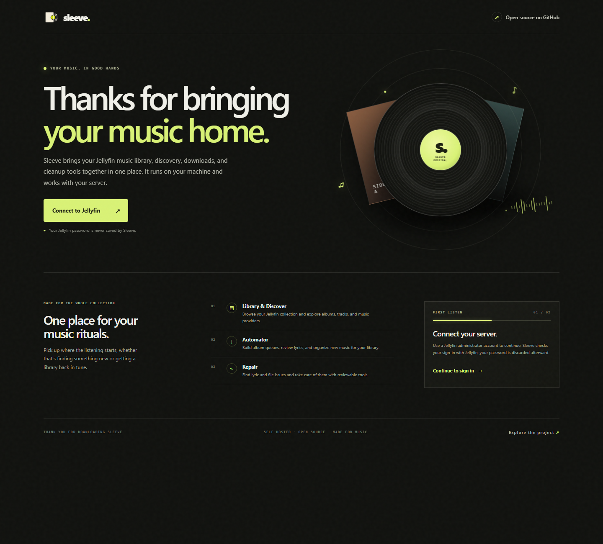

# Sleeve


A self-hosted music utility for browsing a Jellyfin music library, discovering albums and tracks, downloading audio, and maintaining lyric files and album folders.

## Preview



## What it does

- **Library:** browse and filter albums from a configured Jellyfin server.
- **Discover:** browse current charts and new albums, search enabled music catalogs, and queue track or album downloads.
- **Automator:** collect albums, review lyric matches, fetch and verify tracks, write tags and lyrics, and sync the finished album to Jellyfin.
- **Repair:** find broken or missing lyrics, write manual or uploaded LRC files, detect duplicates, and review filename/track-number fixes.
- **Downloads:** monitor and cancel active jobs, then retrieve completed files.

## Quick start

See [Setup and configuration](docs/SETUP.md) for prerequisites, FFmpeg installation, provider credentials, and troubleshooting.

```powershell
py -3 -m venv .venv
.\.venv\Scripts\Activate.ps1
python -m pip install -r requirements.txt
python -m uvicorn app:app --host 127.0.0.1 --port 5000
```

Visit <http://127.0.0.1:5000> to see the welcome screen and connect Jellyfin with an administrator account. Sleeve remembers the server address in its local Automator profile, but never stores your Jellyfin password. For remote access, place Sleeve behind HTTPS; see the [setup guide](docs/SETUP.md).

### Run with Docker

Install Docker Desktop (Windows/macOS) or Docker Engine with the Compose plugin (Linux), copy `.env.example` to `.env`, and set `SLEEVE_MUSIC_PATH` to the host's music folder. Then run:

```shell
docker compose up --build -d
```

Open <http://127.0.0.1:5000>. Docker Compose keeps Sleeve's profile, cookies, caches, and downloads in a persistent named volume; the music folder is mounted read/write at `/music` for Automator and Repair. See [Docker setup](docs/SETUP.md#docker) for Jellyfin connectivity and volume details.

## Project guide

- [Architecture and external services](docs/ARCHITECTURE.md)
- [Contributing](CONTRIBUTING.md)
- [MIT License](LICENSE)

The frontend uses plain JavaScript and CSS, with no package manager or build step. The main FastAPI application is `app:app`.

## Local data and privacy

The app writes browser cookies, the Automator profile (including its Jellyfin API key), caches, temporary audio, and downloads to the per-user data directory (see [Setup](docs/SETUP.md)). The profile is stored in `automator_profile.sqlite3`; obsolete JSON profiles are removed during the one-time first-run profile reset and are not imported. Login passwords and Jellyfin access tokens are not stored. Existing root-level settings are copied on first run and left untouched, except for the obsolete profile files. `.gitignore` also excludes local data files. Review `git status` before sharing a checkout, and never publish `.env`, `automator_profile.sqlite3`, `automator_profile.json`, `cookie.txt`, or `cookies.txt`.
